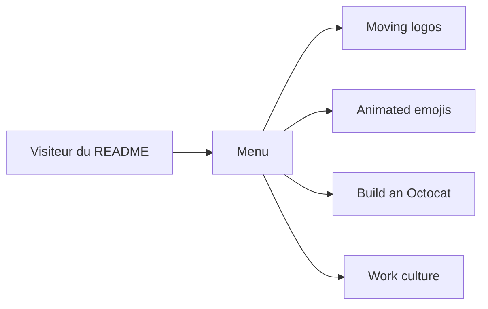

# Anmol-Baranwal/Cool-GIFs-For-GitHub

> Galerie de GIFs et visuels à intégrer dans les README et profils GitHub.

## Le problème
Rendre un README ou un profil GitHub plus vivant demande de trouver des visuels animés.

## Ce que ça fait vraiment
Une galerie Markdown classée par catégories : logos animés, icônes sociales, émojis animés, bannières « hello », Octocat, avatars, « Work culture », stickers, bannières. Le dépôt n'expose que `README.md` et `index.html` : pas de code applicatif.

## Comment c'est branché

## Essayer
Aucune commande : parcourir le README et copier les liens des GIFs.

## Coût et pièges
Gratuit. Dernier push en septembre 2024. Les droits des GIFs repris ne sont pas précisés.

## Ce que ce n'est pas
Pas un outil ni une bibliothèque : une collection de médias.

## Alternatives
Aucune alternative nommée dans le README.

## Pour toi
À ignorer : décoration de profil, sans valeur technique pour data/IA/MLOps.

