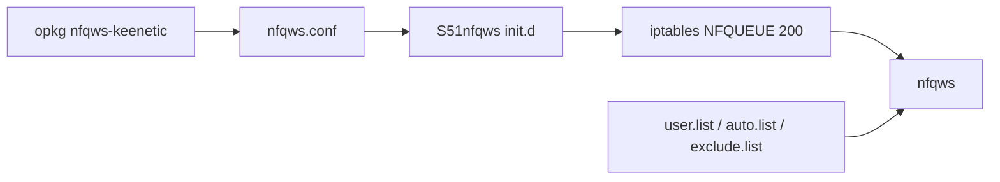

# Anonym-tsk/nfqws-keenetic

> Packages to install nfqws, a TCP packet modification tool, on Keenetic, OpenWRT and Padavan routers.

## The problem
Bypass network blocks at the router level by modifying packets, without configuring each device.

## What it actually does
- Installs nfqws through an opkg repository (or apk on recent OpenWRT) on a router with Entware.
- nfqws processes traffic through NFQUEUE; iptables rules on the configured TCP/UDP ports.
- Three modes: user list, automatic detection of unreachable domains, or all traffic.
- Keenetic access policy, domain and IP lists, a strategy search script.

## How it is wired


## Trying it
```bash
opkg update
opkg install ca-certificates wget-ssl
echo "src/gz nfqws-keenetic https://nfqws.github.io/nfqws-keenetic/all" > /opt/etc/opkg/nfqws-keenetic.conf
opkg update
opkg install nfqws-keenetic
```

## Cost and gotchas
Free, but a compatible router, Entware and Netfilter modules are required. Hardware offloading can prevent iptables from working. Use at your own risk.

## What it is not
The project is no longer updated: new features go into nfqws2-keenetic. The README specifies use for scientific and technical purposes, with possible legal risks. README in Russian.

## Alternatives
nfqws2-keenetic: active successor cited in the README.

## For you
Ignore: frozen project, outside the data/AI/MLOps scope, and its use may raise a legal problem depending on the country.
