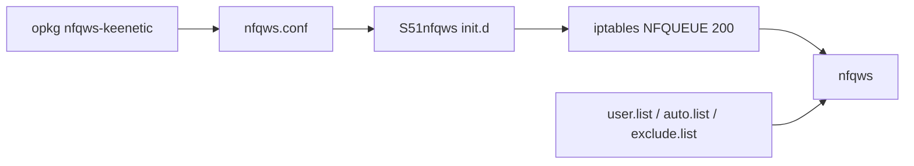

# Anonym-tsk/nfqws-keenetic

> Paquets pour installer nfqws, outil de modification de paquets TCP, sur routeurs Keenetic, OpenWRT et Padavan.

## Le problème
Contourner à l'échelle du routeur des blocages réseau en modifiant les paquets, sans configurer chaque appareil.

## Ce que ça fait vraiment
- Installe nfqws via un dépôt opkg (ou apk sous OpenWRT récent) sur routeur avec Entware.
- nfqws traite le trafic via NFQUEUE ; règles iptables sur les ports TCP/UDP configurés.
- Trois modes : liste utilisateur, détection automatique de domaines inaccessibles, ou tout le trafic.
- Politique d'accès Keenetic, listes de domaines et d'IP, script de recherche de stratégie.

## Comment c'est branché


## Essayer
```bash
opkg update
opkg install ca-certificates wget-ssl
echo "src/gz nfqws-keenetic https://nfqws.github.io/nfqws-keenetic/all" > /opt/etc/opkg/nfqws-keenetic.conf
opkg update
opkg install nfqws-keenetic
```

## Coût et pièges
Gratuit, mais routeur compatible, Entware et modules Netfilter requis. L'offloading matériel peut empêcher iptables de fonctionner. Usage à tes risques.

## Ce que ce n'est pas
Le projet n'est plus mis à jour : les nouveautés vont dans nfqws2-keenetic. Le README précise un usage à but scientifique et technique, avec risques juridiques possibles. README en russe.

## Alternatives
nfqws2-keenetic : successeur actif cité dans le README.

## Pour toi
Ignorer : projet gelé, hors du périmètre data/IA/MLOps, et son usage peut poser un problème légal selon le pays.

