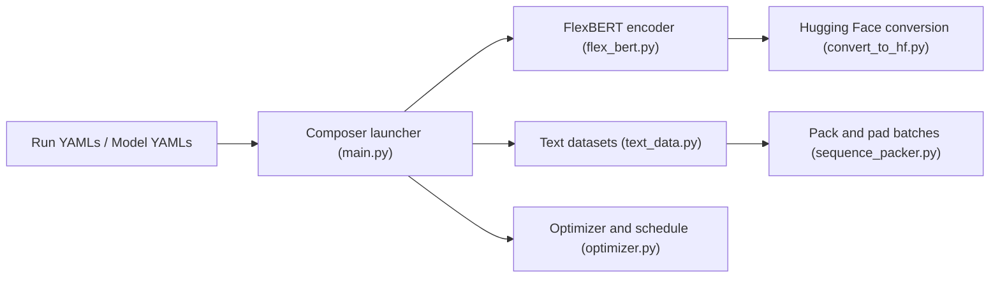

# AnswerDotAI/ModernBERT

> Research repository for pretraining and evaluating the ModernBERT and FlexBERT encoders.

## The problem
BERT-style encoders have aged; their modernization (architecture, long context, scale) needs to be reproducible.

## What it actually does
`main.py` reads a YAML and assembles the FlexBERT model, data loaders, optimizer and Composer trainer. Provides MDS data preparation, sequence packing, GLUE and SuperGLUE evaluations, retrieval examples (Sentence Transformers, ColBERT via PyLate), conversion to Hugging Face and W&B logging. The README describes itself as "very bare-bones".

## How it is wired


## Trying it
```bash
conda env create -f environment.yaml
conda activate bert24
composer main.py yamls/main/modernbert-base.yaml
```

## Cost and gotchas
GPU required; Flash Attention 2 (or 3 on H100) must be compiled or installed via wheel. `NoStreamingDataset` requires decompressed MDS data.

## What it is not
Not the usage version: to use the model in a pipeline, the README points to the Hugging Face collection. Intermediate checkpoints: release announced but not done.

## Alternatives
- MosaicBERT: the code's base, of which this repository extends a fork.
- ModernBERT collection on Hugging Face: for everyday use.

## For you
Worth watching: useful for reproducing or adapting an encoder pretraining; for inference, use the Hugging Face models directly.
