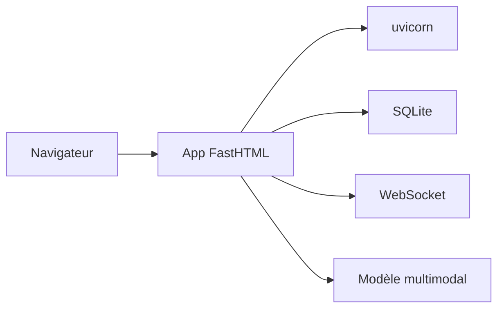

# AnswerDotAI/fasthtml-example

> Collection of FastHTML example applications for learning to build web interfaces in Python.

## The problem
Learning FastHTML takes concrete examples beyond the basic documentation.

## What it actually does
Four detailed applications: a Game of Life synchronized over WebSocket, a to-do list with SQLite, a chatbot styled with DaisyUI, and a Pictionary that sends drawings to a multimodal model to caption them. There are also small demos and utilities, proofs of concept rather than finished applications.

## How it is wired
Simplified diagram based on the fiche, no diagram provided.


## Trying it
```bash
pip install -r requirements.txt
uvicorn main:app
python main.py
```

## Cost and gotchas
Free. Each application has its own directory and its own README; dependencies must be installed per application. The Pictionary calls an AI model: the key would be at your expense, but the README does not specify it.

## What it is not
Not a library or a proven architecture model: these are demos. The README does not detail FastHTML itself.

## Alternatives
No alternative named in the README.

## For you
Worth watching: handy for quickly putting a Python interface around a model (chatbot, demo), to browse rather than install.
