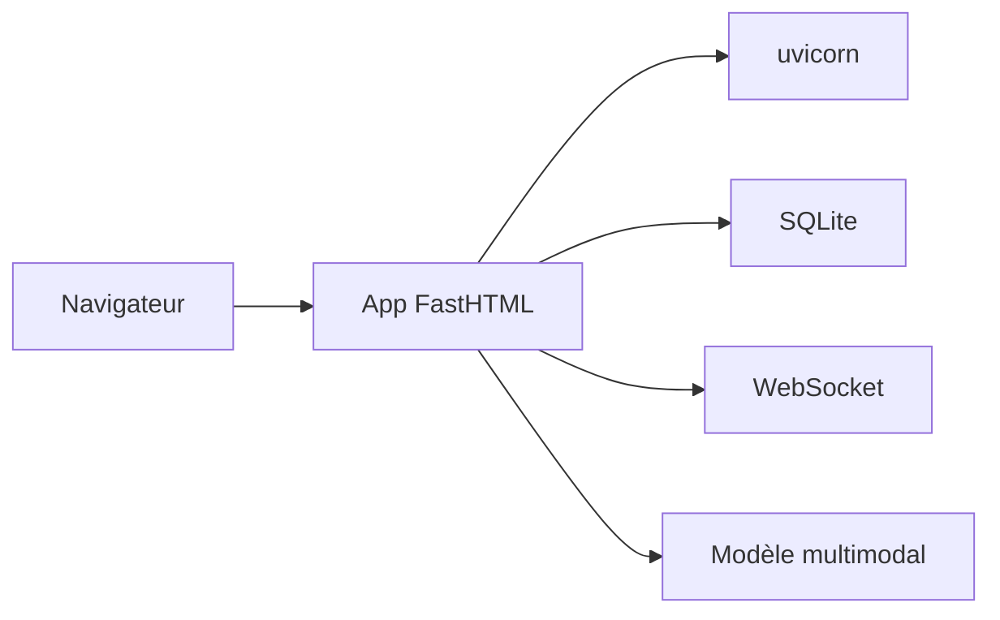

# AnswerDotAI/fasthtml-example

> Collection d'applications d'exemple FastHTML pour apprendre à construire des interfaces web en Python.

## Le problème
Découvrir FastHTML demande des exemples concrets au-delà de la documentation de base.

## Ce que ça fait vraiment
Quatre applications détaillées : jeu de la vie synchronisé par WebSocket, liste de tâches avec SQLite, chatbot stylé avec DaisyUI et Pictionary qui envoie les dessins à un modèle multimodal pour les légender. S'y ajoutent de petites démos et utilitaires, des preuves de concept plutôt que des applications finies.

## Comment c'est branché
Schéma simplifié d'après la fiche, sans diagramme fourni.


## Essayer
```bash
pip install -r requirements.txt
uvicorn main:app
python main.py
```

## Coût et pièges
Gratuit. Chaque application a son répertoire et son propre README ; les dépendances sont à installer par application. Le Pictionary appelle un modèle d'IA : la clé serait à ta charge, mais le README ne la précise pas.

## Ce que ce n'est pas
Pas une bibliothèque ni un modèle d'architecture éprouvé : ce sont des démos. Le README ne détaille pas FastHTML lui-même.

## Alternatives
Aucune alternative nommée dans le README.

## Pour toi
À surveiller : pratique pour monter vite une interface Python autour d'un modèle (chatbot, démo), à consulter plutôt qu'à installer.

