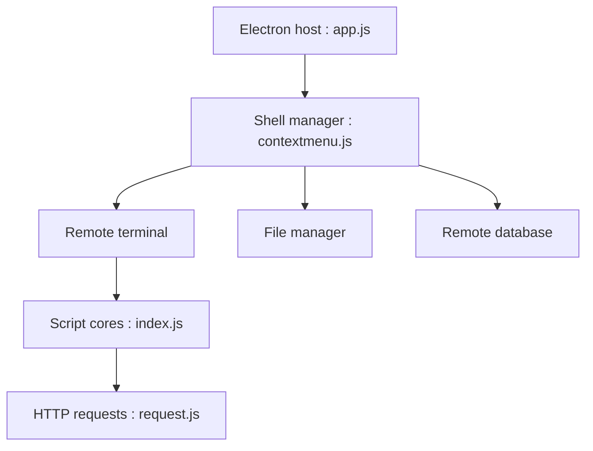

# AntSword/antSword

> Cross-platform website administration tool using webshells, aimed at authorized pentesters and webmasters.

## The problem
Driving webshells (terminal, files, database) from a single interface during authorized penetration tests.

## What it actually does
An Electron application: you register target shells, then open a remote terminal, file manager, database or site view. "Cores" per script family, encoders/decoders, a plugin store and an update service complete the whole.

## How it is wired


## Trying it
```bash
# Aucune commande dans le README : renvoie vers la documentation « Quick Start » externe.
```

## Cost and gotchas
Free. The README forbids illegal use and the publication of unauthorized modified versions. Reserve its use for targets you are authorized to test.

## What it is not
Not a development or AI tool. It is an offensive security tool: nothing for data or MLOps.

## Alternatives
No alternative named in the README.

## For you
Ignore: outside your data/AI scope, and a sensitive tool requiring a clear authorization framework.
