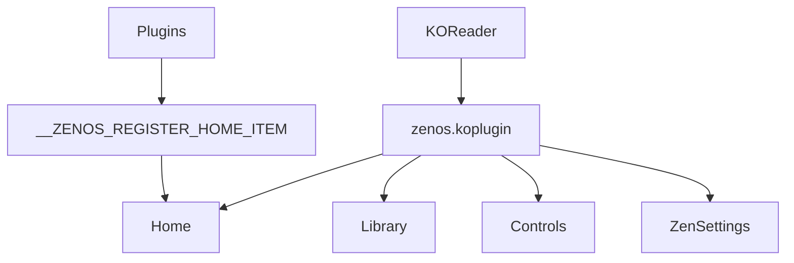

# AnthonyGress/zen_ui.koplugin

> KOReader plugin (ZenOS) that replaces the e-reader interface with a customizable home screen, library and settings.

## The problem
KOReader's default interface is dense and hard to configure. This plugin replaces it with a cleaner layer.

## What it actually does
- Widget-based home page (date, current book, stats, goals, quotes) with presets.
- Controls panel (swipe down), Launcher, navigation bar with up to seven tabs.
- Library as a grid or detailed list, metadata fetched via Hardcover, Google Books, Open Library.
- Zen, Lockdown and Incognito modes; brightness schedules; Lua API so other plugins can add widgets.

## How it is wired

No diagram provided: schema derived from the README.

## Trying it
```bash
# Pas de commande : installation manuelle
# 1. Télécharger zenos.koplugin.zip depuis les Releases
# 2. Dézipper et copier le dossier zenos.koplugin dans le dossier plugins de KOReader
#    (ex. Kobo : /mnt/onboard/.adds/koreader/plugins/)
# 3. Redémarrer KOReader
```

## Cost and gotchas
Free. Requires KOReader 2026.03 or later; automatically disables several other interface plugins and is incompatible with Project: Title (remove it first).

## What it is not
Not a standalone application: it only works inside KOReader. Migrating from Zen UI forces two automatic restarts. Nothing related to data or AI.

## Alternatives
- joshuacant/ProjectTitle: the plugin it draws inspiration from, incompatible when used simultaneously.
- doctorhetfield-cmd/simpleui.koplugin: another KOReader interface plugin, automatically disabled by ZenOS.

## For you
Outside your data / AI / MLOps scope: only useful if you read on a KOReader e-reader, so ignore it for your watch.
