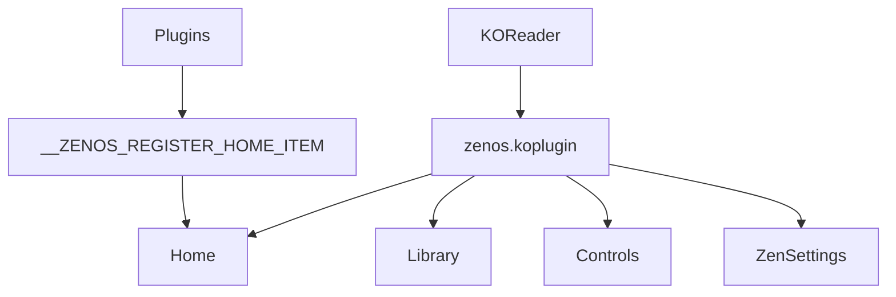

# AnthonyGress/zen_ui.koplugin

> Plugin KOReader (ZenOS) qui remplace l'interface des liseuses par une accueil, une bibliothèque et des réglages personnalisables.

## Le problème
L'interface par défaut de KOReader est dense et peu configurable. Ce plugin la remplace par une couche plus épurée.

## Ce que ça fait vraiment
- Page d'accueil à widgets (date, livre en cours, stats, objectifs, citations) avec préréglages.
- Panneau Controls (balayage vers le bas), Launcher, barre de navigation à sept onglets maximum.
- Bibliothèque en mosaïque ou liste détaillée, métadonnées récupérées via Hardcover, Google Books, Open Library.
- Modes Zen, Lockdown, Incognito ; plannings de luminosité ; API Lua pour que d'autres plugins ajoutent des widgets.

## Comment c'est branché

Pas de diagramme fourni : schéma tiré du README.

## Essayer
```bash
# Pas de commande : installation manuelle
# 1. Télécharger zenos.koplugin.zip depuis les Releases
# 2. Dézipper et copier le dossier zenos.koplugin dans le dossier plugins de KOReader
#    (ex. Kobo : /mnt/onboard/.adds/koreader/plugins/)
# 3. Redémarrer KOReader
```

## Coût et pièges
Gratuit. Exige KOReader 2026.03 ou plus ; désactive automatiquement plusieurs autres plugins d'interface et incompatible avec Project: Title (à retirer avant).

## Ce que ce n'est pas
Pas une application autonome : il ne fonctionne que dans KOReader. La migration depuis Zen UI impose deux redémarrages automatiques. Rien de lié aux données ou à l'IA.

## Alternatives
- joshuacant/ProjectTitle : le plugin dont il s'inspire, incompatible en simultané.
- doctorhetfield-cmd/simpleui.koplugin : autre plugin d'interface KOReader, désactivé automatiquement par ZenOS.

## Pour toi
Hors de ton périmètre data / IA / MLOps : utile seulement si tu lis sur une liseuse KOReader, donc à ignorer pour ta veille.

