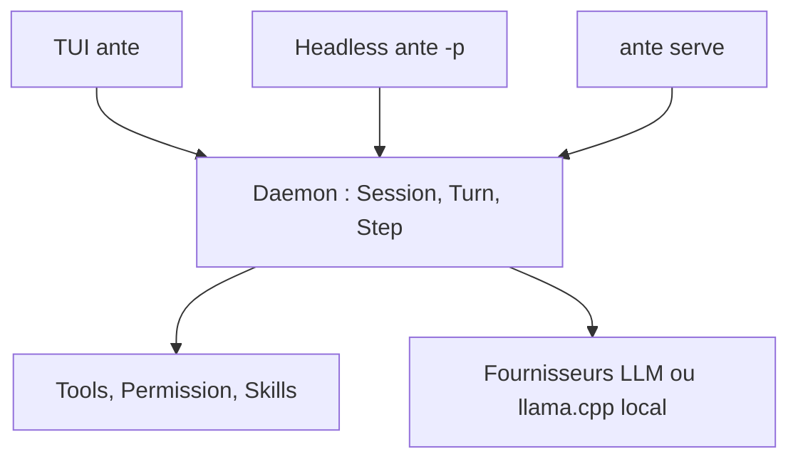

# AntigmaLabs/ante

> Terminal coding agent written in Rust, a single binary, for developers who want a lightweight agent.

## The problem
Terminal coding agents (Claude Code, Codex) bundle Node or Python, weigh heavily on memory and are tied to a specific model.

## What it actually does
A single Rust executable (about 15 MB compressed) runs an interactive or headless agent (`ante -p`). It accepts several model providers, or a local GGUF model through a managed llama.cpp. A settings file defines the prompt, tools and skills; `/term` drives other agents via tmux. It is a beta version: breaking changes are announced.

## How it is wired
Simplified diagram based on the sheet, no diagram provided.


## Trying it
```bash
curl -fsSL https://ante.run/install.sh | bash
ante
ante -p "find and fix the failing test in src/auth"
ante --offline-model ~/.ante/models/Qwen3.5-9B-Q4_K_M.gguf -p "add error handling to src/main.rs"
```

## Cost and gotchas
Remote provider: API key and bill are on you. Offline mode: you need a GGUF model and suitable RAM. macOS and Linux only, WSL on Windows; `/term` requires tmux.

## What it is not
Not a model, only the harness. The benchmark and memory figures come from the vendor. Beta status: API and behaviors may change.

## Alternatives
- Claude Code: a more established ecosystem, but Node dependencies and an imposed model.
- Codex: same category of agent, cited in the README as a reference.

## For you
Worth watching: a lightweight, offline harness is of interest to an MLOps profile, but the beta status and the lack of third-party reviews suggest waiting.
