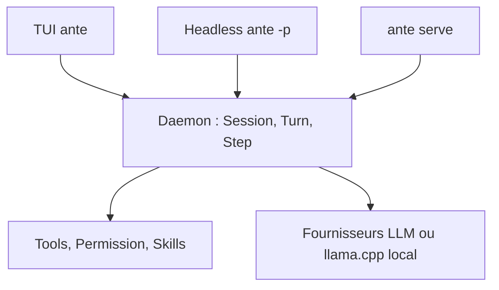

# AntigmaLabs/ante

> Agent de code en terminal, écrit en Rust, un seul binaire, pour développeurs qui veulent un agent léger.

## Le problème
Les agents de code en terminal (Claude Code, Codex) embarquent Node ou Python, pèsent lourd en mémoire et se lient à un modèle précis.

## Ce que ça fait vraiment
Un exécutable Rust unique (environ 15 Mo compressé) lance un agent interactif ou headless (`ante -p`). Il accepte plusieurs fournisseurs de modèles, ou un modèle GGUF local via un llama.cpp géré. Un fichier de réglages définit prompt, outils et skills ; `/term` pilote d'autres agents via tmux. Une version bêta : des changements cassants sont annoncés.

## Comment c'est branché
Schéma simplifié d'après la fiche, sans diagramme fourni.


## Essayer
```bash
curl -fsSL https://ante.run/install.sh | bash
ante
ante -p "find and fix the failing test in src/auth"
ante --offline-model ~/.ante/models/Qwen3.5-9B-Q4_K_M.gguf -p "add error handling to src/main.rs"
```

## Coût et pièges
Fournisseur distant : clé d'API et facture à ta charge. Mode hors ligne : il faut un modèle GGUF et la RAM adaptée. macOS et Linux seulement, WSL sous Windows ; `/term` exige tmux.

## Ce que ce n'est pas
Pas un modèle, seulement le harnais. Les chiffres de benchmark et de mémoire viennent de l'éditeur. Statut bêta : API et comportements peuvent changer.

## Alternatives
- Claude Code : écosystème plus installé, mais dépendances Node et modèle imposé.
- Codex : même catégorie d'agent, cité dans le README comme référence.

## Pour toi
À surveiller : un harnais léger et hors ligne intéresse un profil MLOps, mais la bêta et l'absence d'avis tiers invitent à attendre.

