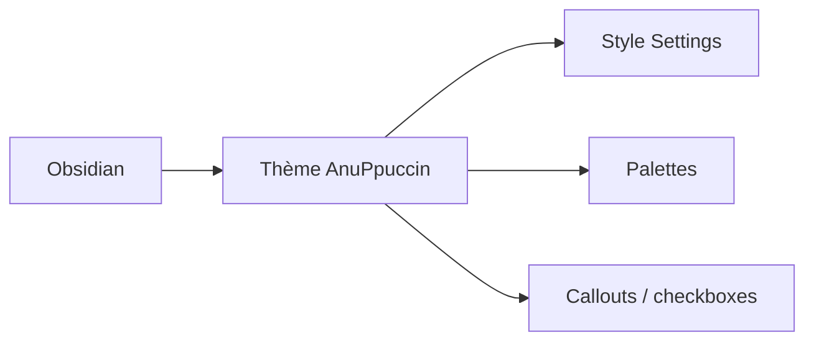

# AnubisNekhet/AnuPpuccin

> Highly configurable Obsidian theme, based on palettes such as Catppuccin or Dracula, for Obsidian users.

## The problem
Obsidian's default look is hard to customize without writing CSS.

## What it actually does
CSS theme with palettes (Atom, Catppuccin, Gruvbox, Nord, Solarized…), two layouts, rainbow folders, custom callouts, checkboxes and bubbles, colored frames. Most settings go through the Style Settings plugin; the theme remains usable without it. Excalidraw and Kanban integrations.

## How it is wired

## Trying it
No command documented in the README: install via Obsidian's themes.

## Cost and gotchas
Free. Last push in December 2024 and 115 open issues. The author says they made it for themselves.

## What it is not
Not a functional plugin: appearance only. The README does not document the installation procedure.

## Alternatives
Kepano's Minimal, from which it borrows some style ideas (cited in the README).

## For you
To ignore: Obsidian cosmetics, no data/AI contribution, and activity stopped in late 2024.
