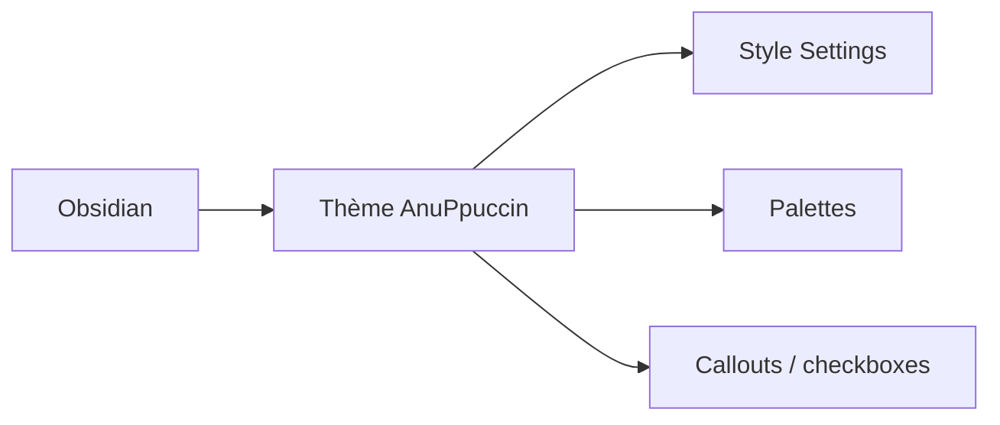

# AnubisNekhet/AnuPpuccin

> Thème Obsidian très configurable, basé sur des palettes comme Catppuccin ou Dracula, pour utilisateurs d'Obsidian.

## Le problème
L'apparence par défaut d'Obsidian est peu personnalisable sans écrire du CSS.

## Ce que ça fait vraiment
Thème CSS avec palettes (Atom, Catppuccin, Gruvbox, Nord, Solarized…), deux dispositions, dossiers arc-en-ciel, callouts, cases à cocher et bulles personnalisées, cadres colorés. La plupart des réglages passent par le plugin Style Settings ; le thème reste utilisable sans lui. Intégrations Excalidraw et Kanban.

## Comment c'est branché

## Essayer
Aucune commande documentée dans le README : installation via les thèmes d'Obsidian.

## Coût et pièges
Gratuit. Dernier push en décembre 2024 et 115 issues ouvertes. L'auteur dit l'avoir fait pour lui-même.

## Ce que ce n'est pas
Pas un plugin fonctionnel : uniquement de l'apparence. Le README ne documente pas la procédure d'installation.

## Alternatives
Minimal de Kepano, dont il reprend certaines idées de style (cité dans le README).

## Pour toi
À ignorer : cosmétique d'Obsidian, aucun apport data/IA, et l'activité s'est arrêtée fin 2024.

