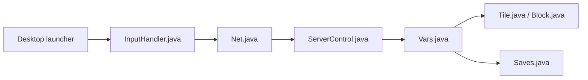

# Anuken/Mindustry

> Tower defense and real-time strategy game centered on automation, written in Java.

## The problem
This is not a tool: it is a game, answering the wish for an RTS where you build production chains.

## What it actually does
The player builds structures and commands units on a tile map, in campaign or multiplayer. The repository also contains a map editor, programmable logic, saves and mod support. Desktop and mobile clients, dedicated server. JDK 17 is required to build.

## How it is wired


## Trying it
```bash
./gradlew desktop:run
./gradlew desktop:dist
./gradlew server:dist
./gradlew android:assembleDebug
```

## Cost and gotchas
Free. JDK 17 only: other versions do not work. The `mindustry.gen` package is generated at build time.

## What it is not
Not a productivity or data tool. The game is distributed on itch.io, Google Play, F-Droid and Flathub.

## Alternatives
No alternative named in the README.

## For you
Ignore it: a game unrelated to your work, even if mature; only the programmable logic might amuse you.
