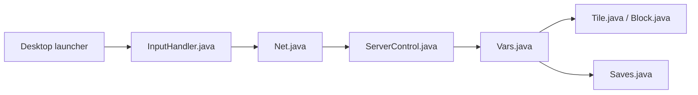

# Anuken/Mindustry

> Jeu de tower defense et de stratégie temps réel centré sur l'automatisation, écrit en Java.

## Le problème
Ce n'est pas un outil : c'est un jeu, qui répond à l'envie d'un RTS où l'on construit des chaînes de production.

## Ce que ça fait vraiment
Le joueur bâtit des structures et commande des unités sur une carte à tuiles, en campagne ou en multijoueur. Le dépôt contient aussi un éditeur de cartes, une logique programmable, des sauvegardes et un support de mods. Clients desktop et mobile, serveur dédié. Il faut le JDK 17 pour compiler.

## Comment c'est branché


## Essayer
```bash
./gradlew desktop:run
./gradlew desktop:dist
./gradlew server:dist
./gradlew android:assembleDebug
```

## Coût et pièges
Gratuit. JDK 17 uniquement : les autres versions ne fonctionnent pas. Le paquet `mindustry.gen` est généré à la compilation.

## Ce que ce n'est pas
Pas un outil de productivité ni de data. Le jeu est distribué sur itch.io, Google Play, F-Droid et Flathub.

## Alternatives
Aucune alternative nommée dans le README.

## Pour toi
À ignorer : jeu sans lien avec ton métier, même s'il est mature ; seule la logique programmable pourrait amuser.

