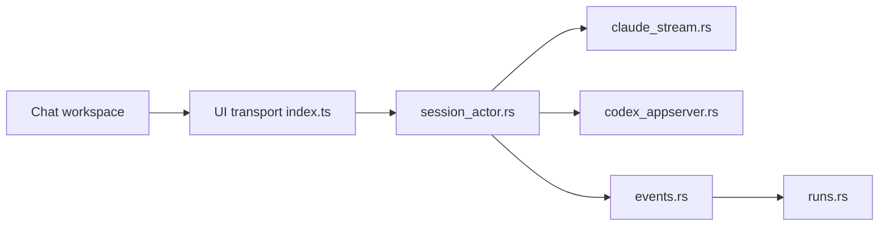

# AnyiWang/OpenCovibe

> Local desktop application that wraps the Claude Code and Codex CLIs in an interface with history and diffs.

## The problem
Coding agent CLIs make it hard to follow long sessions, review visually and manage across sessions.

## What it actually does
Tauri v2 interface (Rust + Svelte 5) that drives the CLIs via the stream-JSON protocol (Claude) or `app-server` (Codex). Tool cards with diffs, replayable history, switching between Anthropic-compatible providers, file explorer, memory editor, permission rules, usage analytics, team board, MCP, token-protected remote browser access. Data in `~/.opencovibe/`.

## How it is wired


## Trying it
```bash
git clone https://github.com/AnyiWang/OpenCovibe.git
cd OpenCovibe
./scripts/setup.sh
npm install
npm run tauri dev
```

## Cost and gotchas
The CLIs and their models are at your expense. macOS and Windows packages are unsigned (warnings on first launch); development mostly on macOS.

## What it is not
Not a new agent: it wraps existing CLIs. No cloud backend, but the model APIs remain remote.

## Alternatives
No alternative named in the README.

## For you
Worth watching: comfortable for following and replaying Claude Code sessions, but single maintainer and unsigned builds; Apache-2.0.
