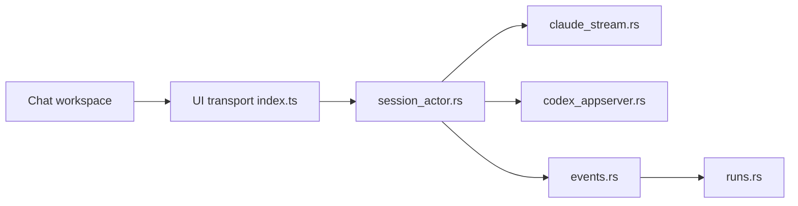

# AnyiWang/OpenCovibe

> Application de bureau locale qui enveloppe les CLI Claude Code et Codex dans une interface avec historique et diffs.

## Le problème
Les CLI d'agent de code rendent difficiles le suivi de longues sessions, la relecture visuelle et la gestion entre sessions.

## Ce que ça fait vraiment
Interface Tauri v2 (Rust + Svelte 5) qui pilote les CLI par protocole stream-JSON (Claude) ou `app-server` (Codex). Cartes d'outils avec diffs, historique rejouable, bascule de fournisseurs compatibles Anthropic, explorateur de fichiers, éditeur de mémoire, règles de permission, analytique d'usage, tableau d'équipes, MCP, accès navigateur distant protégé par jeton. Données dans `~/.opencovibe/`.

## Comment c'est branché


## Essayer
```bash
git clone https://github.com/AnyiWang/OpenCovibe.git
cd OpenCovibe
./scripts/setup.sh
npm install
npm run tauri dev
```

## Coût et pièges
Les CLI et leurs modèles sont à ta charge. Paquets macOS et Windows non signés (avertissements au premier lancement) ; développement surtout sur macOS.

## Ce que ce n'est pas
Pas un nouvel agent : il enveloppe des CLI existants. Pas de backend cloud, mais les API de modèles restent distantes.

## Alternatives
Aucune alternative nommée dans le README.

## Pour toi
À surveiller : confortable pour suivre et rejouer des sessions Claude Code, mais mainteneur unique et builds non signés ; Apache-2.0.

