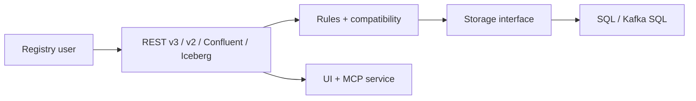

# Apicurio/apicurio-registry

> API and schema registry: stores, versions and validates artifacts via a REST API.

## The problem
Schemas (Avro, JSON Schema, OpenAPI…) diverge between teams without a versioned registry with compatibility rules.

## What it actually does
A Quarkus service exposing REST v2/v3 APIs, a Confluent-compatible API and an Iceberg API. Manages versions, search, rules and compatibility, and contract governance (ODCS projection). Storage: memory, SQL or Kafka SQL, with Elasticsearch search. Adds a web interface, an MCP service, A2A agent cards and prompt rendering. Optional OIDC authentication.

## How it is wired


## Trying it
```bash
./mvnw clean install -Dlocal -DskipTests
cd app/
../mvnw quarkus:dev -Dlocal
docker run -it -p 8080:8080 apicurio/apicurio-registry:latest-snapshot
```

## Cost and gotchas
JDK 21+ to build. Memory mode loses data. OIDC to be configured via environment variables. 802 open issues.

## What it is not
Not a Kafka broker: a schema and API registry. The `latest-snapshot` images are development builds.

## Alternatives
None named in the README (a Confluent-compatible API is offered).

## For you
Worth watching if you manage data schemas or contracts for Kafka/ML flows: a useful open registry, with no immediate need otherwise.
