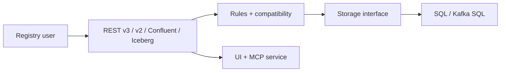

# Apicurio/apicurio-registry

> Registre d'API et de schémas : stocke, versionne et valide des artefacts via une API REST.

## Le problème
Les schémas (Avro, JSON Schema, OpenAPI…) divergent entre équipes sans registre versionné avec règles de compatibilité.

## Ce que ça fait vraiment
Service Quarkus exposant des API REST v2/v3, une API compatible Confluent et une API Iceberg. Gère versions, recherche, règles et compatibilité, gouvernance de contrats (projection ODCS). Stockage : mémoire, SQL ou Kafka SQL, recherche Elasticsearch. Ajoute interface web, service MCP, cartes d'agents A2A et rendu de prompts. Authentification OIDC optionnelle.

## Comment c'est branché


## Essayer
```bash
./mvnw clean install -Dlocal -DskipTests
cd app/
../mvnw quarkus:dev -Dlocal
docker run -it -p 8080:8080 apicurio/apicurio-registry:latest-snapshot
```

## Coût et pièges
JDK 21+ pour compiler. Le mode mémoire perd les données. OIDC à configurer via variables d'environnement. 802 issues ouvertes.

## Ce que ce n'est pas
Pas un broker Kafka : un registre de schémas et d'API. Les images `latest-snapshot` sont de développement.

## Alternatives
Aucune nommée dans le README (une API compatible Confluent est proposée).

## Pour toi
À surveiller si tu gères des schémas de données ou des contrats pour des flux Kafka/ML : un registre ouvert utile, sans besoin immédiat sinon.

