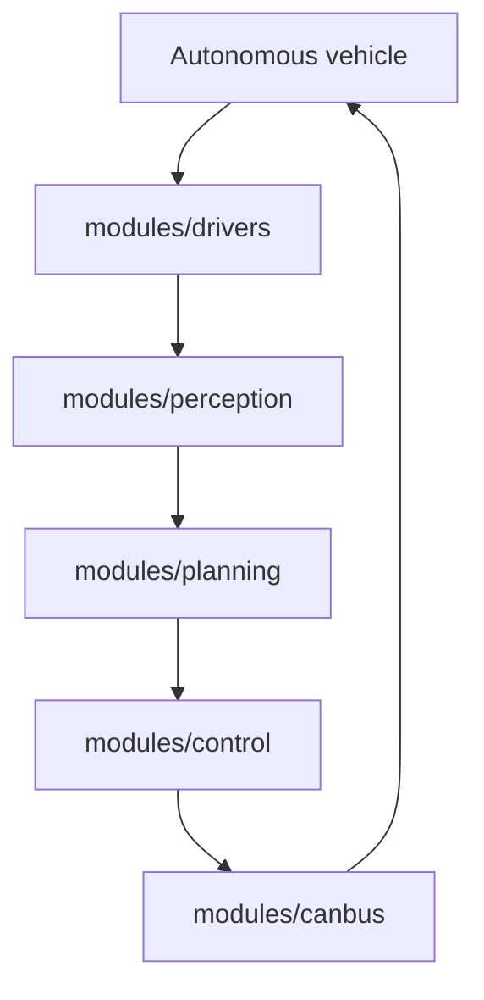

# ApolloAuto/apollo

> Open source autonomous driving platform (Baidu): perception, planning, control and development tools.

## The problem
Developing, testing and deploying autonomous vehicles without rebuilding the whole software stack.

## What it actually does
Perception modules (LiDAR, 4D radar), localization, maps, scenario- and plugin-based planning, control, sensor drivers, CAN gateway, the Cyber RT runtime and the Dreamview Plus interface. An OTA client exists. Exact wiring not established in the architecture provided.

## How it is wired


## Trying it
```bash
rm -rf /apollo/.cache/{bazel,build,repos}
./docker/scripts/dev_start.sh
```
Full installation: see the software guide in the README.

## Cost and gotchas
Prerequisites: 8 cores, 16 GB of RAM, NVIDIA GPU recommended (CUDA 11.8), Docker and NVIDIA Container Toolkit. A drive-by-wire vehicle (Lincoln MKZ tested) is needed for real hardware.

## What it is not
Not a turnkey product: the code does not cover commercialization cybersecurity (disclaimer). Not a personal-computer project.

## Alternatives
None named in the README.

## For you
Ignore unless you have an autonomous driving project: the domain and hardware are far from the usual data/MLOps profile.
