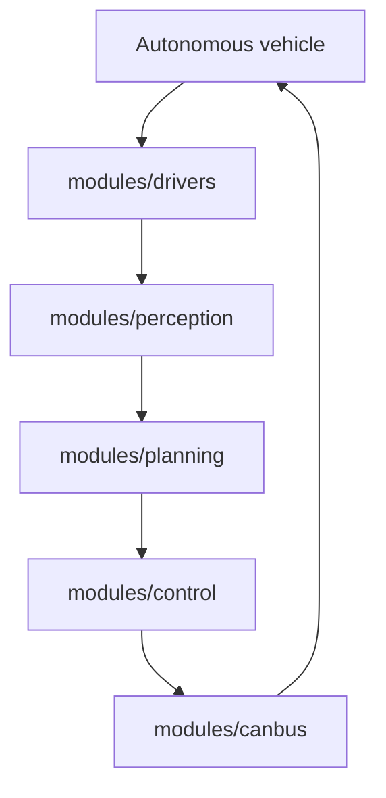

# ApolloAuto/apollo

> Plateforme open source de conduite autonome (Baidu) : perception, planification, contrôle et outils de développement.

## Le problème
Développer, tester et déployer des véhicules autonomes sans reconstruire toute la pile logicielle.

## Ce que ça fait vraiment
Modules perception (LiDAR, radar 4D), localisation, cartes, planification par scénarios et plugins, contrôle, pilotes capteurs, passerelle CAN, runtime Cyber RT et interface Dreamview Plus. Un client OTA existe. Câblage exact non établi dans l'architecture fournie.

## Comment c'est branché


## Essayer
```bash
rm -rf /apollo/.cache/{bazel,build,repos}
./docker/scripts/dev_start.sh
```
Installation complète : guide logiciel du README.

## Coût et pièges
Prérequis : 8 cœurs, 16 Go de RAM, GPU NVIDIA recommandé (CUDA 11.8), Docker et NVIDIA Container Toolkit. Véhicule à commande by-wire (Lincoln MKZ testé) pour le matériel réel.

## Ce que ce n'est pas
Pas un produit clé en main : le code ne couvre pas la cybersécurité de commercialisation (disclaimer). Pas un projet d'ordinateur personnel.

## Alternatives
Aucune nommée dans le README.

## Pour toi
À ignorer sauf projet de conduite autonome : domaine et matériel éloignés du profil data/MLOps courant.

