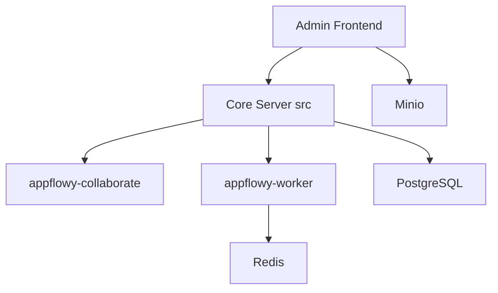

# AppFlowy-IO/AppFlowy-Cloud

> Former open source AppFlowy server, archived in favor of a closed commercial version.

## The problem
Self-host a collaborative Notion-style notes workspace, without depending on a third-party cloud.

## What it actually does
The repository is archived: the README redirects to AppFlowy-SelfHost-Commercial, whose Docker images come from closed code. The former Rust code included an API server, a WebSocket collaboration service, a worker, PostgreSQL, Redis and Minio.

## How it is wired


## Trying it
```bash
git clone https://github.com/AppFlowy-IO/AppFlowy-SelfHost-Commercial
cd AppFlowy-SelfHost-Commercial
cp deploy.env .env
docker compose up -d
```

## Cost and gotchas
Free tier: one seat, three guest editors. Beyond that, paid plans. Do not build the server from this repository: missing features.

## What it is not
No longer a maintained project, nor fully open source on the server side (open-core model).

## Alternatives
- AppFlowy-SelfHost-Commercial: the version to deploy today.

## For you
Ignore: archived repository, the current server is closed and limited in its free version.
