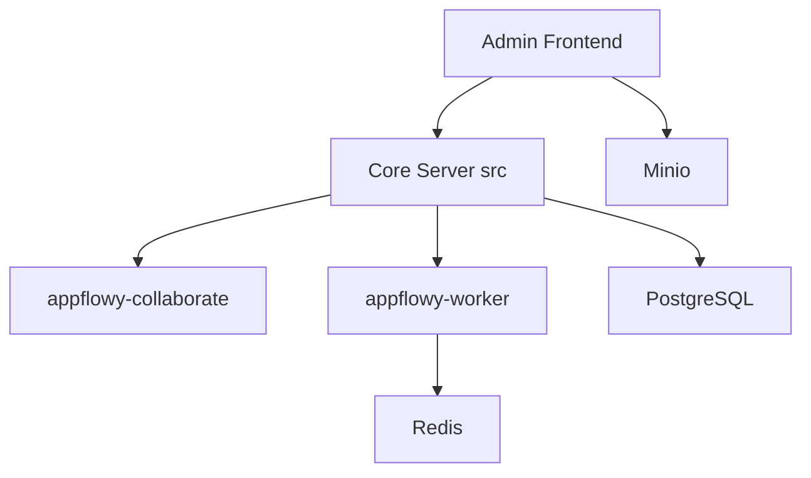

# AppFlowy-IO/AppFlowy-Cloud

> Ancien serveur open source d'AppFlowy, archivé au profit d'une version commerciale fermée.

## Le problème
Héberger soi-même un espace de notes collaboratif façon Notion, sans dépendre d'un cloud tiers.

## Ce que ça fait vraiment
Le dépôt est archivé : le README redirige vers AppFlowy-SelfHost-Commercial, dont les images Docker viennent d'un code fermé. L'ancien code Rust comprenait un serveur d'API, un service de collaboration par WebSocket, un worker, PostgreSQL, Redis et Minio.

## Comment c'est branché


## Essayer
```bash
git clone https://github.com/AppFlowy-IO/AppFlowy-SelfHost-Commercial
cd AppFlowy-SelfHost-Commercial
cp deploy.env .env
docker compose up -d
```

## Coût et pièges
Palier gratuit : un siège, trois éditeurs invités. Au-delà, offres payantes. Ne pas compiler le serveur depuis ce dépôt : fonctionnalités manquantes.

## Ce que ce n'est pas
Plus un projet maintenu ni entièrement open source côté serveur (modèle open-core).

## Alternatives
- AppFlowy-SelfHost-Commercial : la version à déployer aujourd'hui.

## Pour toi
Ignorer : dépôt archivé, le serveur actuel est fermé et limité en version gratuite.

