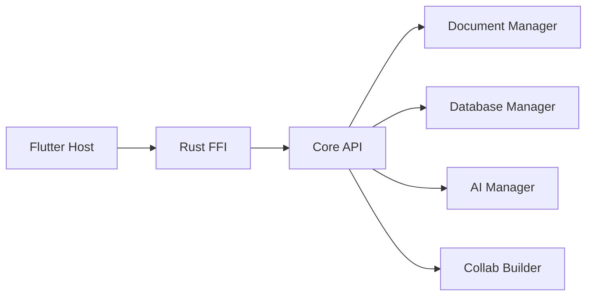

# AppFlowy-IO/AppFlowy

> Open-source AI workspace, an alternative to Notion that keeps users in control of their data.

## The problem
Notion limits data security and mobile compatibility; other tools have their own limitations.

## What it actually does
Flutter client (for desktop, iOS, and Android) built on top of a Rust core: This includes document management, databases, file storage, collaboration features, and local or cloud-based AI functions. An FFI layer connects the interface to the document and database management systems. It can be self-hosted.

## How it is wired

## Trying it
The README does not provide any instructions: downloading the desktop application, FlatHub/Snapcraft packages, or self-hosting via the documentation.

## Cost and gotchas
The client is free of charge; the README mentions AppFlowy Cloud and an AI provider, but does not specify pricing. AGPL-3.0 license: obligations apply if you modify and expose the service.

## What it is not
The README acknowledges that it does not claim to surpass Notion in terms of features at this stage.

## Alternatives
Notion, mentioned as a comparison point (not free).

## For you
Things to watch out for: Potentially useful for building a team knowledge base, but it's not a data/AI tool, and the AGPL license requires caution.
