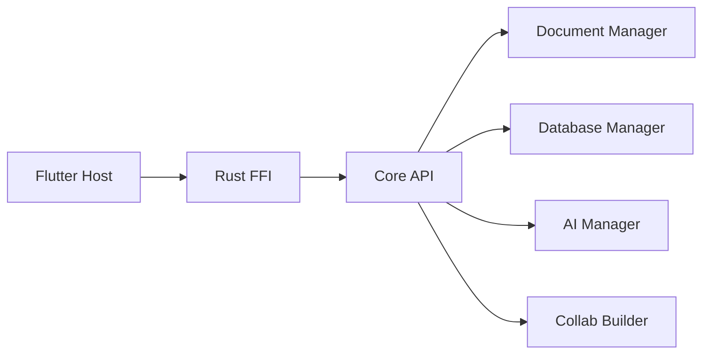

# AppFlowy-IO/AppFlowy

> Espace de travail IA open source, alternative à Notion, qui garde le contrôle des données.

## Le problème
Notion limite la sécurité des données et la compatibilité mobile ; les outils concurrents ont leurs propres contraintes.

## Ce que ça fait vraiment
Client Flutter (bureau, iOS, Android) au-dessus d'un cœur Rust : documents, bases de données, dossiers, stockage de fichiers, collaboration et fonctions IA locales ou cloud. Une couche FFI relie l'interface aux gestionnaires de documents et de bases. Peut s'auto-héberger.

## Comment c'est branché

## Essayer
Le README ne donne aucune commande : téléchargement de l'application de bureau, paquets FlatHub/Snapcraft, auto-hébergement via la documentation.

## Coût et pièges
Le client est gratuit ; le README évoque AppFlowy Cloud et un fournisseur d'IA sans détailler les tarifs. Licence AGPL-3.0 : obligations si tu modifies et exposes le service.

## Ce que ce n'est pas
Le README reconnaît ne pas prétendre dépasser Notion en fonctionnalités à ce stade.

## Alternatives
Notion, cité comme point de comparaison (non libre).

## Pour toi
À surveiller : intéressant pour une base de connaissances d'équipe maîtrisée, mais ce n'est pas un outil data / IA et l'AGPL impose de la prudence.

