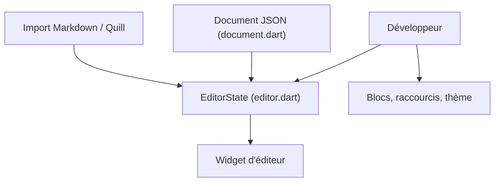

# AppFlowy-IO/appflowy-editor

> Flutter package for building customizable rich-text editors.

## The problem
Building a rich editor in a Flutter application is slow without ready-made components.

## What it actually does
Provides an `EditorState`, an editor widget, block components, shortcuts, themes, a selection menu and a toolbar. Creation from empty, from JSON, from Markdown or from Quill Delta. The repository also contains HTML and PDF exports depending on the tree structure.

## How it is wired


## Trying it
```bash
flutter pub add appflowy_editor
flutter pub get
git clone https://github.com/AppFlowy-IO/appflowy-editor.git
flutter run
```

## Cost and gotchas
Free. Requires Flutter / Dart. The license present is not identified by GitHub: to be verified. Many open issues (165).

## What it is not
Not a finished editing application: it is a building block for Flutter developers.

## Alternatives
No alternative named in the README.

## For you
Mobile UI building block unrelated to data / AI: ignore.
