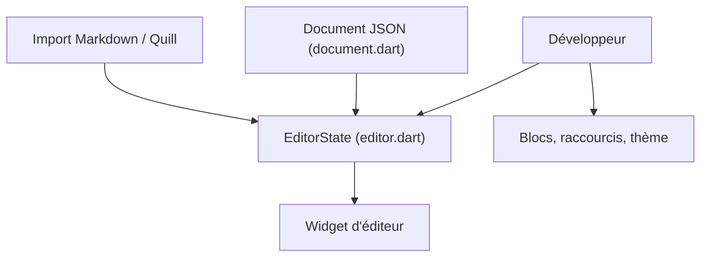

# AppFlowy-IO/appflowy-editor

> Paquet Flutter pour construire des éditeurs de texte riche personnalisables.

## Le problème
Créer un éditeur riche dans une application Flutter est long sans composants prêts.

## Ce que ça fait vraiment
Fournit un `EditorState`, un widget d'éditeur, des composants de blocs, des raccourcis, des thèmes, un menu de sélection et une barre d'outils. Création à partir de vide, de JSON, de Markdown ou de Quill Delta. Le dépôt contient aussi des exports HTML et PDF selon la structure de l'arbre.

## Comment c'est branché


## Essayer
```bash
flutter pub add appflowy_editor
flutter pub get
git clone https://github.com/AppFlowy-IO/appflowy-editor.git
flutter run
```

## Coût et pièges
Gratuit. Requiert Flutter / Dart. La licence présente n'est pas identifiée par GitHub : à vérifier. Beaucoup d'issues ouvertes (165).

## Ce que ce n'est pas
Pas une application d'édition finie : c'est une brique pour développeurs Flutter.

## Alternatives
Aucune alternative nommée dans le README.

## Pour toi
Brique d'interface mobile sans lien avec la data / IA : à ignorer.

