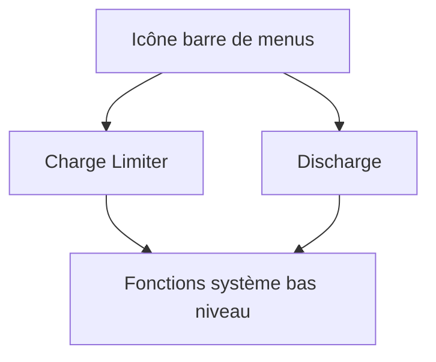

# AppHouseKitchen/AlDente-Battery_Care_and_Monitoring

> macOS menu bar tool that limits the maximum charge of MacBook batteries.

## The problem
Keeping a lithium battery at 100% permanently shortens its lifespan.

## What it actually does
A charge limiter adjustable from 20 to 100%, and a discharge function that makes the Mac run on battery even when plugged in (not compatible with clamshell mode). The paid Pro version adds Heat Protection, Sailing Mode, Top Up and calibration. The README warns that a prolonged low level without a full cycle throws off the calibration.

## How it is wired

Diagram inferred from the README.

## Trying it
```bash
# Aucune commande : télécharger l'app depuis GitHub, puis régler le pourcentage dans la barre de menus.
```

## Cost and gotchas
Limited free version; paid Pro (also on Setapp). The current code is closed: the repository only has old code and archived releases. Use at your own risk.

## What it is not
Not a current open source project despite the public repository. Works on macOS only.

## Alternatives
No alternative named in the README.

## For you
Ignore: proprietary macOS utility unrelated to data / AI, and unclear license for old code.
