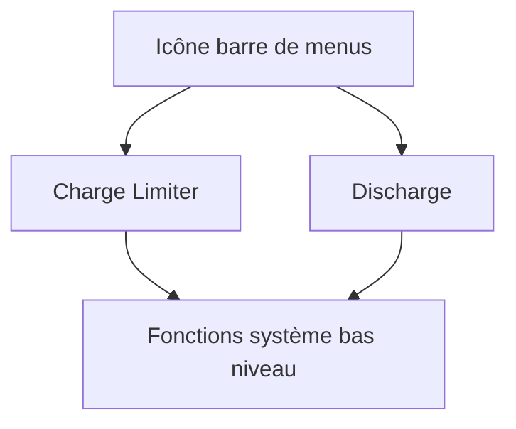

# AppHouseKitchen/AlDente-Battery_Care_and_Monitoring

> Outil de barre de menus macOS qui limite la charge maximale de la batterie des MacBook.

## Le problème
Garder une batterie lithium à 100 % en permanence réduit sa durée de vie.

## Ce que ça fait vraiment
Un limiteur de charge réglable de 20 à 100 %, et une fonction de décharge qui fait tourner le Mac sur batterie même branché (non compatible avec le mode clamshell). La version Pro payante ajoute Heat Protection, Sailing Mode, Top Up et calibration. Le README prévient qu'un niveau bas prolongé sans cycle complet dérègle la calibration.

## Comment c'est branché

Schéma déduit du README.

## Essayer
```bash
# Aucune commande : télécharger l'app depuis GitHub, puis régler le pourcentage dans la barre de menus.
```

## Coût et pièges
Version gratuite limitée ; Pro payant (aussi sur Setapp). Le code actuel est fermé : le dépôt n'a que du code ancien et des releases archivées. Utilisation à tes risques.

## Ce que ce n'est pas
Pas un projet open source actuel malgré le dépôt public. Fonctionne sur macOS uniquement.

## Alternatives
Aucune alternative nommée dans le README.

## Pour toi
Ignorer : utilitaire macOS propriétaire sans lien avec data / IA, et licence floue pour du code ancien.

