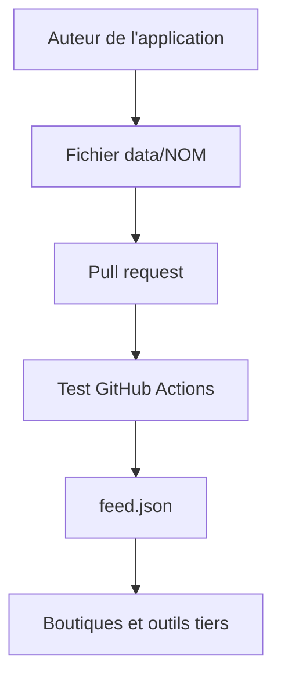

# AppImage/appimage.github.io

> Collaborative directory of tested AppImages, with a JSON feed for Linux app stores.

## The problem
There is no central catalogue of the AppImages available from their authors.

## What it actually does
One application is proposed per file in `data/` (a link to a release repository). A GitHub action downloads the AppImage, runs it offline on the oldest still-supported Ubuntu LTS and posts a screenshot or the error in the pull request. The feed is served at `appimage.github.io/feed.json`, picked up by app stores and by the command-line tools listed.

## How it is wired


## Trying it
```bash
# Aucune commande : ajouter un fichier data/<Nom> contenant l'URL du dépôt, puis ouvrir une pull request.
# Commentaire /retest pour relancer le test.
```

## Cost and gotchas
Free. 5,466 open issues. The feed format is not stabilised.

## What it is not
Distributes no files, does not track versions and guarantees nothing: being listed does not imply trust in the applications.

## Alternatives
No alternative named in the README.

## For you
Ignore: a directory of Linux desktop software, outside your data / AI / MLOps use.
