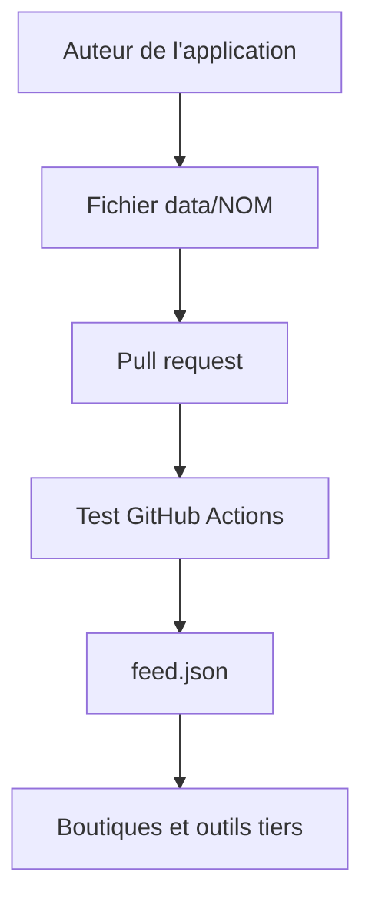

# AppImage/appimage.github.io

> Annuaire collaboratif d'AppImages testées, avec un flux JSON pour boutiques d'applications Linux.

## Le problème
Pas de catalogue central des AppImages disponibles auprès de leurs auteurs.

## Ce que ça fait vraiment
On propose une application par fichier dans `data/` (lien vers le dépôt d'une release). Une action GitHub télécharge l'AppImage, la lance sans réseau sur la plus ancienne Ubuntu LTS encore supportée et publie une capture d'écran ou l'erreur dans la pull request. Le flux est servi sur `appimage.github.io/feed.json`, repris par des boutiques et des outils en ligne de commande listés.

## Comment c'est branché


## Essayer
```bash
# Aucune commande : ajouter un fichier data/<Nom> contenant l'URL du dépôt, puis ouvrir une pull request.
# Commentaire /retest pour relancer le test.
```

## Coût et pièges
Gratuit. 5 466 issues ouvertes. Le format du flux n'est pas stabilisé.

## Ce que ce n'est pas
Ne distribue aucun fichier, ne suit pas les versions et ne garantit rien : n'implique pas la confiance dans les applications listées.

## Alternatives
Aucune alternative nommée dans le README.

## Pour toi
Ignorer : annuaire de logiciels de bureau Linux, hors de ton usage data / IA / MLOps.

