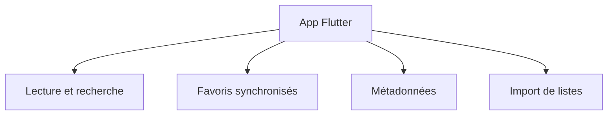

# AprDeci/bili-music

> Music client for Bilibili written in Flutter, for Android, iOS, Windows, Linux and macOS.

## The problem
Listening to Bilibili music goes through a video app. A dedicated cross-platform player is missing.

## What it actually does
Based on the short README: playback and search, favorites synchronization, metadata matching, import of external playlists, dynamic colors. The rest is not documented.

## How it is wired
Simplified diagram based on the sheet, no diagram supplied.

## Trying it
No command documented in the README.

## Cost and gotchas
Not documented: installation and dependencies are not described. Free according to the MIT license.

## What it is not
It is not a documented project: very short README, in Chinese. The author declares it reserved for learning and non-commercial use.

## Alternatives
No alternative named in the README.

## For you
Ignore: a consumer music player, unrelated to data or AI, and with no material to judge it.
