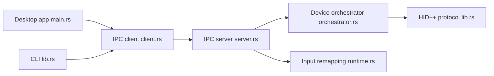

# AprilNEA/OpenLogi

> Lightweight app and CLI to configure Logitech mice, keyboards, lights and webcams without Options+.

## The problem
Logitech's official software is heavy and absent on Linux; you want text-based, scriptable configuration.

## What it actually does
Rust/GPUI desktop application and CLI with a background agent: button remapping, gestures, per-application profiles, action ring, DPI, SmartShift, backlight, Litra lights and UVC webcam controls. Single TOML configuration. The agent talks to the devices over local IPC through HID++.

## How it is wired


## Trying it
```bash
brew install --cask openlogi
curl -fsSL https://github.com/AprilNEA/OpenLogi/releases/latest/download/install.sh | sh
```

## Cost and gotchas
Quit Logi Options+ (and Solaar) first, because only one piece of software can own a receiver. macOS: Accessibility and Input Monitoring permissions. The README warns of active, non-stable development. Logo and brand are all rights reserved, outside the code's license.

## What it is not
Not affiliated with Logitech. Not a data or AI tool.

## Alternatives
Solaar and Mouser, cited in the acknowledgements.

## For you
Ignore for your profile: device utility unrelated to data/AI/MLOps, useful only if you own Logitech hardware on Linux.
