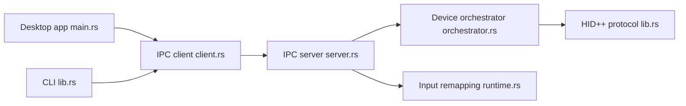

# AprilNEA/OpenLogi

> Application et CLI légers pour configurer souris, claviers, lumières et webcams Logitech sans Options+.

## Le problème
Le logiciel officiel de Logitech est lourd et absent de Linux ; on veut une configuration en texte et scriptable.

## Ce que ça fait vraiment
Application de bureau Rust/GPUI et CLI avec un agent de fond : remappage de boutons, gestes, profils par application, anneau d'actions, DPI, SmartShift, rétroéclairage, lumières Litra et contrôles UVC de webcams. Configuration TOML unique. L'agent dialogue par IPC local avec les périphériques via HID++.

## Comment c'est branché


## Essayer
```bash
brew install --cask openlogi
curl -fsSL https://github.com/AprilNEA/OpenLogi/releases/latest/download/install.sh | sh
```

## Coût et pièges
Quitter Logi Options+ (et Solaar) avant, car un seul logiciel peut posséder un récepteur. macOS : droits Accessibilité et Surveillance de saisie. Le README avertit d'un développement actif non stable. Logo et marque sous droits réservés, hors licence du code.

## Ce que ce n'est pas
Pas affilié à Logitech. Pas un outil data ni IA.

## Alternatives
Solaar et Mouser, cités en remerciements.

## Pour toi
À ignorer pour ton profil : utilitaire de périphériques sans lien avec data/IA/MLOps, utile seulement si tu possèdes du matériel Logitech sous Linux.

