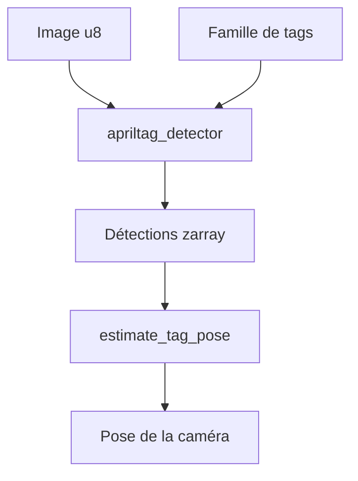

# AprilRobotics/apriltag

> C library for detecting AprilTag visual markers, for robotics and pose estimation.

## The problem
Precisely locating a camera or an object requires robust visual landmarks and a fast detector.

## What it actually does
Detects square or circular tags in a grayscale image and estimates their pose (tag size, focal length, optical center). Detector claimed to be more than twice as fast as version 2, with tag families including `tagStandard41h12` (recommended) and ArUco. Dependency-free C library, with a Python binding.

## How it is wired
Simplified diagram based on the sheet, no diagram provided.



## Trying it
```bash
cmake -B build -DCMAKE_BUILD_TYPE=Release
cmake --build build --target install
./build/opencv_demo
```

## Cost and gotchas
Free. Officially Linux only. License not identified by GitHub. Detector tuning (`quad_decimate`, `nthreads`) trades speed against range.

## What it is not
Not an image acquisition tool: you must supply the images yourself. No built-in camera calibration.

## Alternatives
OpenCV with `SOLVEPNP_IPPE_SQUARE` for pose estimation alone, as mentioned in the README.

## For you
Worth watching: a useful vision building block in robotics or perception, ignore otherwise; read the license before reusing it.
