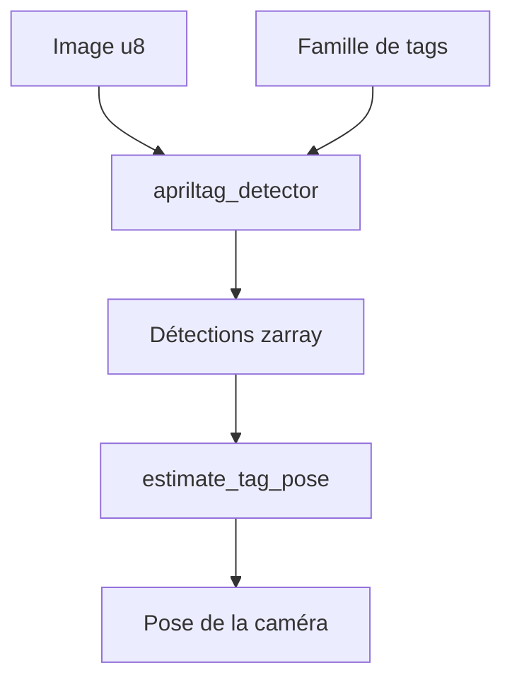

# AprilRobotics/apriltag

> Bibliothèque C de détection de marqueurs visuels AprilTag pour la robotique et l'estimation de pose.

## Le problème
Localiser une caméra ou un objet précisément demande des repères visuels robustes et un détecteur rapide.

## Ce que ça fait vraiment
Détecte des étiquettes carrées ou circulaires dans une image en niveaux de gris et en estime la pose (taille de tag, focale, centre optique). Détecteur annoncé plus de deux fois plus rapide que la version 2, avec familles de tags dont `tagStandard41h12` (recommandée) et ArUco. Bibliothèque C sans dépendance, avec liaison Python.

## Comment c'est branché
Schéma simplifié d'après la fiche, sans diagramme fourni.



## Essayer
```bash
cmake -B build -DCMAKE_BUILD_TYPE=Release
cmake --build build --target install
./build/opencv_demo
```

## Coût et pièges
Gratuit. Officiellement Linux seulement. Licence non identifiée par GitHub. Le réglage du détecteur (`quad_decimate`, `nthreads`) arbitre vitesse et distance.

## Ce que ce n'est pas
Pas un outil d'acquisition d'images : il faut fournir les images soi-même. Pas de recalage de caméra intégré.

## Alternatives
OpenCV avec `SOLVEPNP_IPPE_SQUARE` pour l'estimation de pose seule, indiqué dans le README.

## Pour toi
À surveiller : brique de vision utile en robotique ou en perception, à ignorer sinon ; lire la licence avant réemploi.

