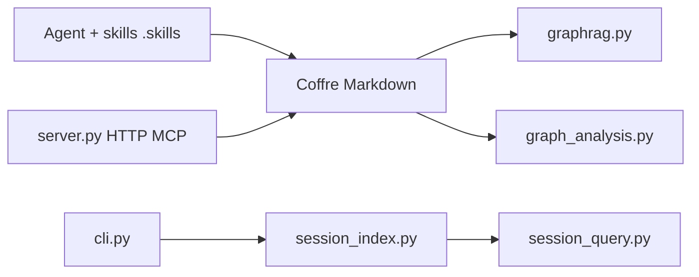

# Ar9av/obsidian-wiki

> Agent skills that compile your notes and conversations into an interlinked Obsidian vault, modeled on Karpathy's LLM wiki.

## The problem
What you learn while solving a problem stays buried in a chat history and is rediscovered from scratch three months later.

## What it actually does
39 Markdown skills (`.skills/`), read by Claude Code, Cursor, Codex and others. They ingest sources (`/wiki-ingest`, `/wiki-update`, `/wiki-capture`, `/wiki-history-ingest`), merge into existing pages, query with `[[link]]` citations (`/wiki-query`), and clean up (`/wiki-lint`, `/wiki-dedup`). A Python CLI indexes agent sessions and exports the graph (JSON, GraphML, Cypher). Each claim is labeled extracted, inferred or ambiguous.

## How it is wired


## Trying it
```bash
pip install obsidian-wiki
obsidian-wiki setup --vault ~/brain
obsidian-wiki sessions-build
obsidian-wiki sessions-query "the auth bug with the weird retry loop"
```

## Cost and gotchas
No API key of its own: the agent consumes your tokens. A manifest only re-reads modified sources. April 2026 project, very young.

## What it is not
Not a standalone application: everything goes through an agent, hence its costs. The README's performance study is tiny (38 pages, two trials per cell) and the author acknowledges it.

## Alternatives
No alternative is named in the README (the starting point is Karpathy's "LLM Wiki" gist).

## For you
Adopt as a trial: local Markdown with no lock-in, MIT, reversible, useful for capitalizing on your agent sessions.
