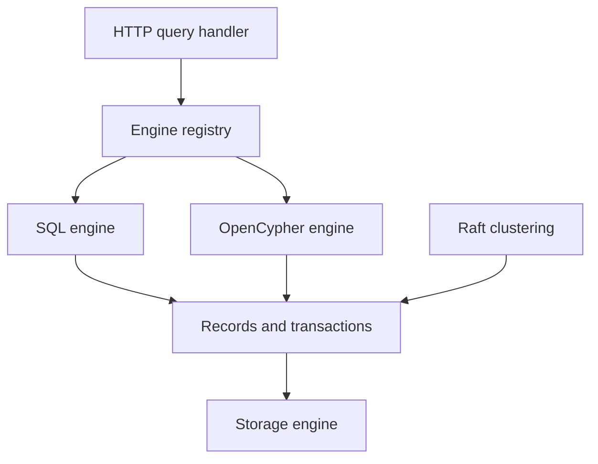

# ArcadeData/arcadedb

> Multi-model database in Java (graph, document, time series, vectors) for data and AI backends.

## The problem
Combining graph, documents, key-value, time series and vectors forces you to manage several different databases.

## What it actually does
A transactional DBMS written in Java 21+. It speaks SQL, Cypher, Gremlin, GraphQL and MongoDB queries, and exposes HTTP, Bolt, the Postgres protocol, Redis (a subset) and an MCP server. It offers 70+ graph algorithms, vector indexes and Raft high availability.

## How it is wired


## Trying it
```bash
docker run --rm -p 2480:2480 \
           -v arcadedb-config:/home/arcadedb/config \
           -v arcadedb-databases:/home/arcadedb/databases \
           -e ARCADEDB_SETTINGS="-Darcadedb.server.rootPassword=playwithdata -Darcadedb.server.defaultDatabases=Imported[root]{import:https://github.com/ArcadeData/arcadedb-datasets/raw/main/orientdb/OpenBeer.gz}" \
           arcadedata/arcadedb:latest
```

## Cost and gotchas
Free; Docker or JVM 21+. The Redis and MongoDB drivers only implement a subset of operations. The example's root password must be changed.

## What it is not
Not a full clone of Neo4j, MongoDB or Redis: compatibility is partial. The README's performance figures were not verified here.

## Alternatives
Neo4j, MongoDB, Redis, InfluxDB and OrientDB are cited as compatible protocols or languages: pick them if you only need a single model.

## For you
Keep an eye on it: one database for graph, vectors and time series can simplify a Graph RAG prototype, but partial compatibility calls for testing.
