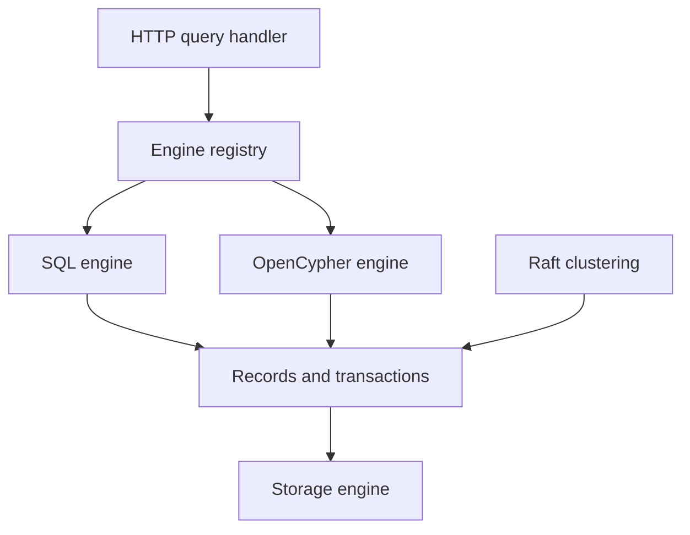

# ArcadeData/arcadedb

> Base de données multi-modèles en Java (graphe, document, séries temporelles, vecteurs) pour backends data et IA.

## Le problème
Combiner graphe, documents, clé-valeur, séries temporelles et vecteurs oblige à gérer plusieurs bases différentes.

## Ce que ça fait vraiment
Un SGBD transactionnel écrit en Java 21+. Il parle SQL, Cypher, Gremlin, GraphQL et les requêtes MongoDB, et expose HTTP, Bolt, protocole Postgres, Redis (sous-ensemble) et un serveur MCP. Il offre 70+ algorithmes de graphe, des index vectoriels et une haute disponibilité Raft.

## Comment c'est branché


## Essayer
```bash
docker run --rm -p 2480:2480 \
           -v arcadedb-config:/home/arcadedb/config \
           -v arcadedb-databases:/home/arcadedb/databases \
           -e ARCADEDB_SETTINGS="-Darcadedb.server.rootPassword=playwithdata -Darcadedb.server.defaultDatabases=Imported[root]{import:https://github.com/ArcadeData/arcadedb-datasets/raw/main/orientdb/OpenBeer.gz}" \
           arcadedata/arcadedb:latest
```

## Coût et pièges
Gratuit ; Docker ou JVM 21+. Les pilotes Redis et MongoDB n'implémentent qu'un sous-ensemble des opérations. Le mot de passe root de l'exemple est à changer.

## Ce que ce n'est pas
Pas un clone complet de Neo4j, MongoDB ou Redis : la compatibilité est partielle. Les chiffres de performance du README n'ont pas été vérifiés ici.

## Alternatives
Neo4j, MongoDB, Redis, InfluxDB et OrientDB sont cités comme protocoles ou langages compatibles : prends-les si tu n'as besoin que d'un seul modèle.

## Pour toi
Surveiller : une seule base pour graphe, vecteurs et séries peut simplifier un prototype de Graph RAG, mais la compatibilité partielle demande des tests.

