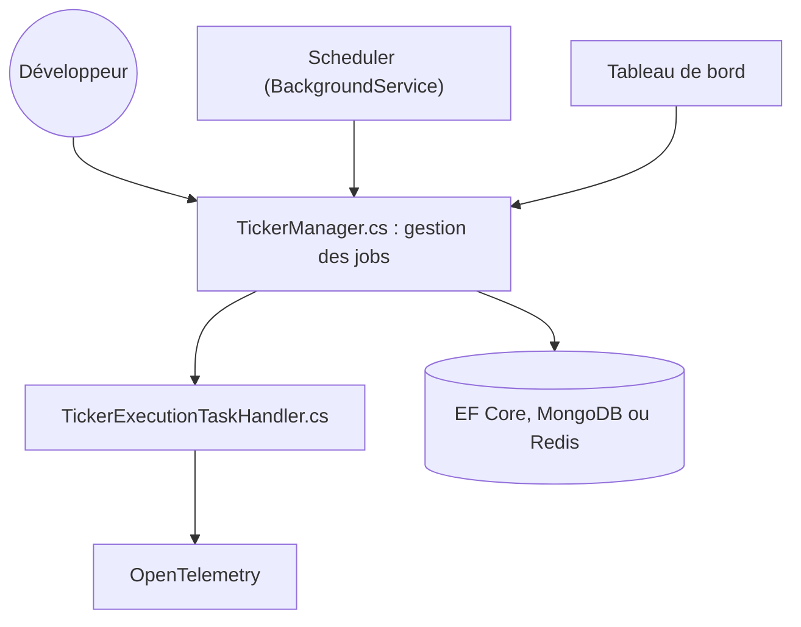

# Arcenox-co/TickerQ

> Background task and workflow scheduler for .NET, with a dashboard.

## The problem
Scheduling recurring tasks, chaining dependent steps and seeing what happened requires in-house tooling.

## What it actually does
C# jobs with compile-time registration, conditional chains, retries, priorities, calendar policies and catch-up of missed tasks. Storage via EF Core, MongoDB or Redis. A web dashboard, optional AI assistance, Slack, Teams or webhook alerts and an OpenTelemetry trace complete the whole. A separate hosted Hub service exists.

## How it is wired

## Trying it
No command is documented in the README: installation and configuration are referred to the documentation, via NuGet packages (TickerQ, TickerQ.Dashboard, etc.).

## Cost and gotchas
Community licence free under US$5 M of annual revenue, with annual renewal; above that, a paid subscription. Hub is a separately hosted service, with its own terms.

## What it is not
Not a classic open licence: GitHub does not identify it, and use depends on eligibility criteria. Not a data pipeline orchestrator.

## Alternatives
- No alternative named in the README.

## For you
Worth watching: useful if you have scheduled tasks in .NET, but the revenue-conditioned licence and the hosted Hub require careful reading before any professional use.
