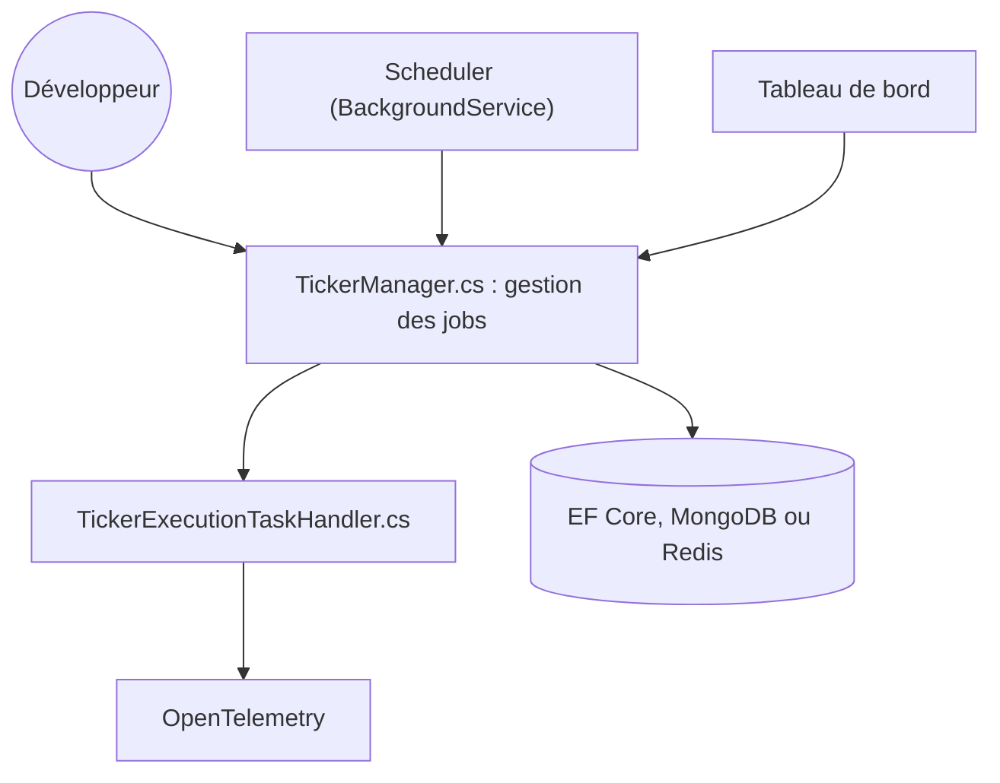

# Arcenox-co/TickerQ

> Ordonnanceur de tâches et de workflows en arrière-plan pour .NET, avec tableau de bord.

## Le problème
Planifier des tâches récurrentes, enchaîner des étapes dépendantes et voir ce qui s'est passé demande de l'outillage maison.

## Ce que ça fait vraiment
Des jobs C# avec enregistrement à la compilation, chaînes conditionnelles, reprises, priorités, politiques de calendrier et rattrapage de tâches manquées. Stockage via EF Core, MongoDB ou Redis. Un tableau de bord web, une assistance IA optionnelle, des alertes Slack, Teams ou webhook et une trace OpenTelemetry complètent l'ensemble. Un service Hub séparé et hébergé existe.

## Comment c'est branché

## Essayer
Aucune commande n'est documentée dans le README : l'installation et la configuration sont renvoyées à la documentation, par paquets NuGet (TickerQ, TickerQ.Dashboard, etc.).

## Coût et pièges
Licence Community gratuite sous 5 M US$ de chiffre d'affaires annuel, avec renouvellement annuel ; au-delà, abonnement payant. Hub est un service hébergé à part, avec ses propres conditions.

## Ce que ce n'est pas
Pas une licence libre classique : GitHub ne l'identifie pas, et l'usage dépend de critères d'éligibilité. Pas un orchestrateur de pipelines de données.

## Alternatives
- Aucune alternative nommée dans le README.

## Pour toi
À surveiller : utile si tu as des tâches planifiées en .NET, mais la licence à conditions de chiffre d'affaires et le Hub hébergé demandent une lecture attentive avant tout usage pro.

