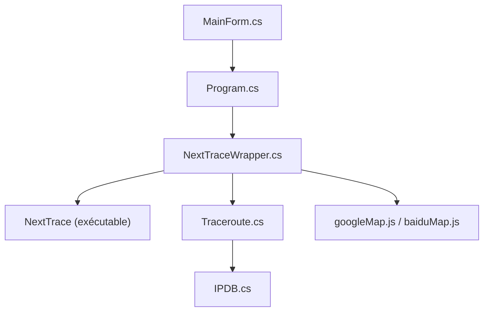

# Archeb/opentrace

> Cross-platform graphical interface for visualizing a traceroute, wrapping the NextTrace tool.

## The problem
Reading a command-line traceroute is not very telling, especially for locating hops on a map.

## What it actually does
Provides a native interface (WPF on Windows, GTK on Linux, macOS) that launches NextTrace and displays the results, with MTR, custom DNS resolvers (DNS, DoH), local MMDB databases and maps. Six languages, command line to start a trace.

## How it is wired


## Trying it
```bash
dotnet restore OpenTrace.csproj
dotnet build OpenTrace.csproj --runtime linux-x64 --configuration Release --self-contained -f net8.0
```
Otherwise, download the release from the website or the releases page.

## Cost and gotchas
Free. NextTrace must be present next to the application (or chosen in the settings). On Windows, Npcap is required for TCP/UDP. GPL-3.0 license.

## What it is not
Not a traceroute engine: all measurement comes from NextTrace.

## Alternatives
No alternative named in the README.

## For you
Ignore: occasional network diagnostics, outside your data, AI or MLOps topics.
