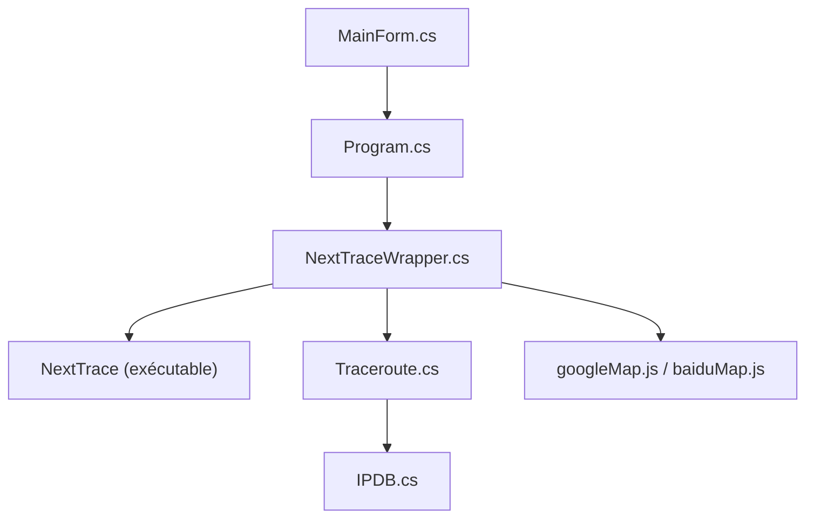

# Archeb/opentrace

> Interface graphique multiplateforme pour visualiser un traceroute, enveloppant l'outil NextTrace.

## Le problème
Lire un traceroute en ligne de commande est peu parlant, surtout pour localiser les sauts sur une carte.

## Ce que ça fait vraiment
Fournit une interface native (WPF sous Windows, GTK sous Linux, macOS) qui lance NextTrace et affiche les résultats, avec MTR, résolveurs DNS personnalisés (DNS, DoH), bases MMDB locales et cartes. Six langues, ligne de commande pour lancer une trace.

## Comment c'est branché


## Essayer
```bash
dotnet restore OpenTrace.csproj
dotnet build OpenTrace.csproj --runtime linux-x64 --configuration Release --self-contained -f net8.0
```
Sinon, télécharger la version depuis le site ou les releases.

## Coût et pièges
Gratuit. NextTrace doit être présent à côté de l'application (ou choisi dans les réglages). Sous Windows, Npcap est requis pour TCP/UDP. Licence GPL-3.0.

## Ce que ce n'est pas
Ce n'est pas un moteur de traceroute : toute la mesure vient de NextTrace.

## Alternatives
Aucune alternative nommée dans le README.

## Pour toi
À ignorer : diagnostic réseau ponctuel, hors de tes sujets data, IA ou MLOps.

