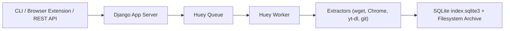

# ArchiveBox/ArchiveBox

> Self-hosted application that archives web pages in durable formats, for individuals and organizations.

## The problem
Pages disappear (link rot) or change, and public archive services do not keep private or login-protected content.

## What it actually does
You give it URLs (CLI, web interface, REST API, browser extension, imports of RSS feeds or bookmarks). It saves each page in several formats: HTML, SingleFile, PDF, PNG screenshot, WARC, article text, media via yt-dlp, git clone. The index is in SQLite and the files on disk. By default it also submits pages to archive.org, which can be disabled.

## How it is wired


## Trying it
```bash
mkdir -p ~/archivebox/data && cd ~/archivebox
curl -fsSL 'https://docker-compose.archivebox.io' > docker-compose.yml
docker compose pull
docker compose up -d --wait
docker compose exec archivebox archivebox add 'https://example.com'
```

## Cost and gotchas
Disk: from ~1 GB to ~50 GB per thousand pages depending on whether yt-dlp is enabled. Private content may leak to third parties (archive.org); the README recommends disabling some extractors. Archived JS is untrusted. Windows is not supported outside Docker/WSL.

## What it is not
It is neither the most faithful nor the simplest archiver, as the README itself says. The REST API is announced as alpha, the Python API as beta.

## Alternatives
- ArchiveWeb.page and ReplayWeb.page: better fidelity for interactive pages.
- Browsertrix: advanced recursive crawling.
- Memex, Hoarder, LinkWarden: more bookmark and note features.

## For you
Watch: useful for freezing watch sources or research articles, with reasonable infrastructure, with no direct link to your pipelines.
