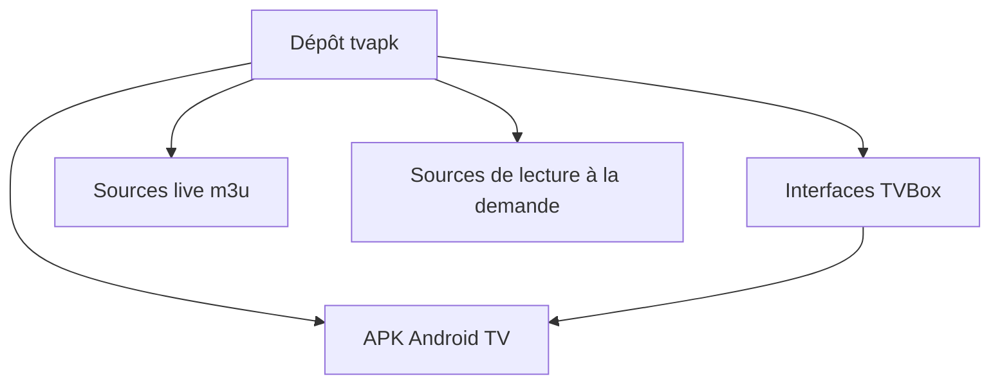

# Archmage83/tvapk

> Collection of APKs for Android TV and playback sources, in Chinese, for watching free content.

## The problem
Video and karaoke services on television are often paid or region-limited.

## What it actually does
List of Android TV applications (video, karaoke, children, education) with versions, TVBox interface addresses and IPTV playlists (m3u). The README promises to watch VIP content for free, sometimes with activation codes provided.

## How it is wired
Simplified diagram based on the fiche, no diagram provided.

## Trying it
No documented command.

## Cost and gotchas
Free, but the APKs are of unknown provenance and links may die. The interface and source addresses come from third parties, some via mirrors. The displayed Apache-2.0 license does not cover these third-party applications.

## What it is not
Not code: it is a directory of links. It guarantees neither the security nor the legality of the content.

## Alternatives
No alternative named in the README.

## For you
Ignore: unverifiable APK files and probably pirated content, unrelated to data, AI or MLOps work.
