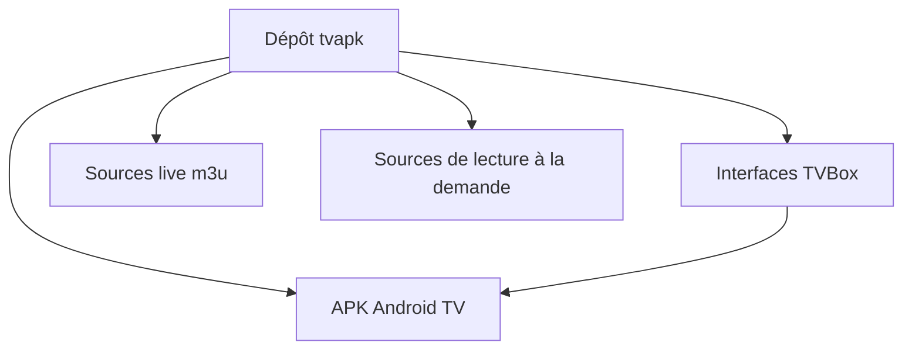

# Archmage83/tvapk

> Collection d'APK pour Android TV et de sources de lecture, en chinois, pour regarder du contenu gratuit.

## Le problème
Les services de vidéo et de karaoké sur télévision sont souvent payants ou limités par région.

## Ce que ça fait vraiment
Liste d'applications Android TV (vidéo, karaoké, enfants, éducation) avec versions, des adresses d'interfaces pour TVBox et des listes de lecture IPTV (m3u). Le README promet de regarder des contenus VIP gratuitement, parfois avec des codes d'activation donnés.

## Comment c'est branché
Schéma simplifié d'après la fiche, sans diagramme fourni.

## Essayer
Aucune commande documentée.

## Coût et pièges
Gratuit, mais les APK sont de provenance inconnue et les liens peuvent mourir. Les adresses d'interfaces et de sources viennent de tiers, certaines via des miroirs. La licence Apache-2.0 affichée ne couvre pas ces applications tierces.

## Ce que ce n'est pas
Ce n'est pas du code : c'est un répertoire de liens. Il ne garantit ni la sécurité ni la légalité des contenus.

## Alternatives
Aucune alternative nommée dans le README.

## Pour toi
À ignorer : fichiers APK non vérifiables et contenus probablement piratés, sans rapport avec le travail data, IA ou MLOps.

