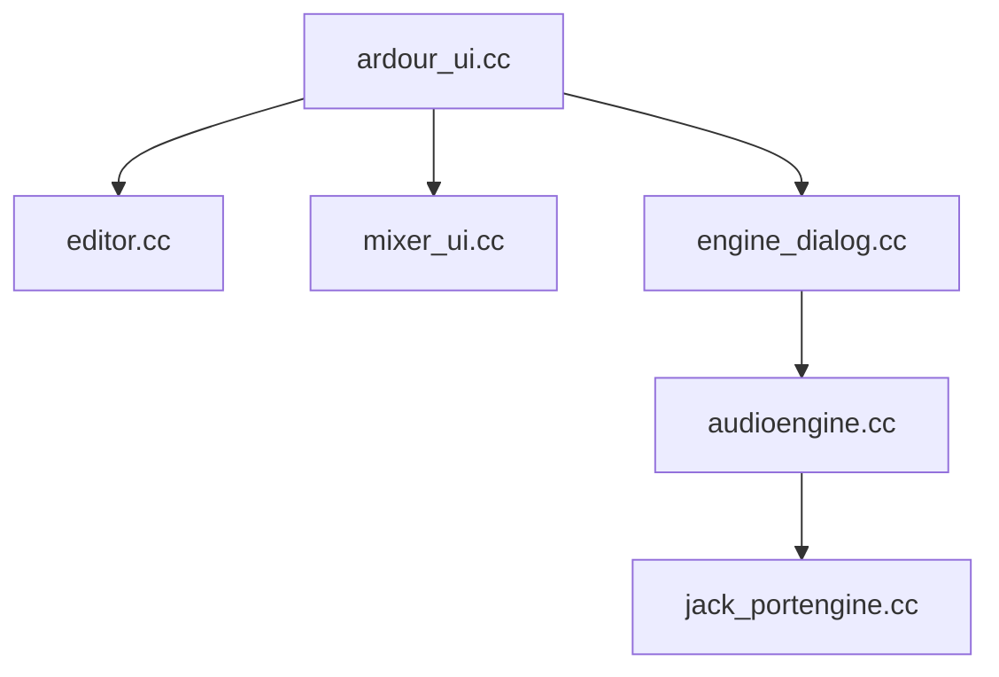

# Ardour/ardour

> Desktop digital audio workstation: recording, editing, mixing and MIDI.

## The problem
Recording, editing and mixing multitrack audio requires a full audio workstation.

## What it actually does
The README contains only two links (website and development page). Based on the code architecture: GTK application with a timeline editor, mixer, audio engine, JACK backend, MIDI editing, plugins, video, export, triggers and Lua scripts.

## How it is wired

## Trying it
No command documented in the README; see https://ardour.org/development.html for building.

## Cost and gotchas
Price and prerequisites not documented here. License present but not identified by GitHub: to be checked.

## What it is not
Not an audio processing library nor a machine learning tool. The repository explains nothing itself.

## Alternatives
No alternative named in the README.

## For you
Ignore: music production, unrelated to data, AI or MLOps work.
