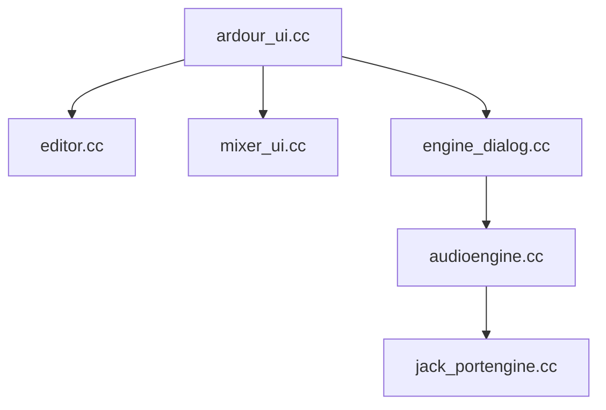

# Ardour/ardour

> Station audio numérique de bureau : enregistrement, édition, mixage et MIDI.

## Le problème
Enregistrer, monter et mixer de l'audio multipiste demande une station de travail audio complète.

## Ce que ça fait vraiment
Le README ne contient que deux liens (site et page de développement). D'après l'architecture du code : application GTK avec éditeur de chronologie, mixeur, moteur audio, backend JACK, édition MIDI, plugins, vidéo, export, déclencheurs et scripts Lua.

## Comment c'est branché

## Essayer
Aucune commande documentée dans le README ; voir https://ardour.org/development.html pour la compilation.

## Coût et pièges
Prix et prérequis non documentés ici. Licence présente mais non identifiée par GitHub : à vérifier.

## Ce que ce n'est pas
Pas une librairie de traitement audio ni un outil de machine learning. Le dépôt n'explique rien lui-même.

## Alternatives
Aucune alternative nommée dans le README.

## Pour toi
À ignorer : production musicale, sans rapport avec un travail data, IA ou MLOps.

