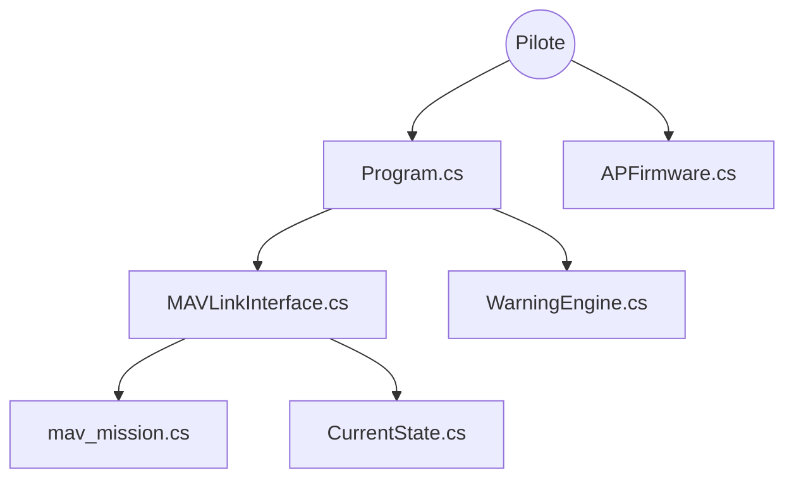

# ArduPilot/MissionPlanner

> Ground control station to configure and fly ArduPilot drones and vehicles.

## The problem
Preparing a mission, following telemetry and updating the firmware of an ArduPilot vehicle requires dedicated software.

## What it actually does
Connects to the vehicle over MAVLink, plans missions, displays telemetry on a map, manages firmware, analyzes flight logs and raises alerts. Maps come from the provider of your choice, with offline caching. The README details each external service and how to turn it off. A root certificate is installed to sign serial port drivers.

## How it is wired


## Trying it
```bash
git submodule update --init
./Linux/build.sh
./Linux/run.sh
```
On Windows: open MissionPlanner.sln in Visual Studio 2022.

## Cost and gotchas
Free. Windows recommended; Linux via Mono with missing features. Anonymous Google Analytics is active (can be disabled in Config > Planner). Calls to firmware.ardupilot.org are sometimes not blockable. GPL-3.0 license.

## What it is not
Not a flight simulator: it controls a real or simulated vehicle via SITL.

## Alternatives
No alternative named in the README.

## For you
Ignore: a drone tool, outside the data/AI scope, except for analyzing flight logs as a dataset.
