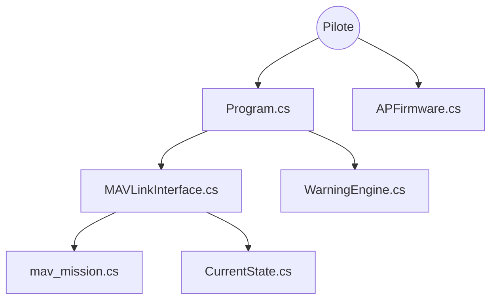

# ArduPilot/MissionPlanner

> Station de contrôle au sol pour configurer et piloter les drones et véhicules ArduPilot.

## Le problème
Préparer une mission, suivre la télémétrie et mettre à jour le firmware d'un véhicule ArduPilot demande un logiciel dédié.

## Ce que ça fait vraiment
Se connecte au véhicule par MAVLink, planifie les missions, affiche la télémétrie sur carte, gère le firmware, analyse les journaux de vol et lève des alertes. Les cartes viennent du fournisseur de ton choix, avec cache hors ligne. Le README détaille chaque service externe et comment le couper. Un certificat racine est installé pour signer les pilotes de port série.

## Comment c'est branché


## Essayer
```bash
git submodule update --init
./Linux/build.sh
./Linux/run.sh
```
Sous Windows : ouvrir MissionPlanner.sln dans Visual Studio 2022.

## Coût et pièges
Gratuit. Windows recommandé ; Linux via Mono avec des fonctions manquantes. Google Analytics anonyme actif (désactivable dans Config > Planner). Appels vers firmware.ardupilot.org parfois non coupables. Licence GPL-3.0.

## Ce que ce n'est pas
Pas un simulateur de vol : il pilote un véhicule réel ou simulé via SITL.

## Alternatives
Aucune alternative nommée dans le README.

## Pour toi
À ignorer : outil de drone, hors du périmètre data/IA, sauf analyse de journaux de vol comme jeu de données.

